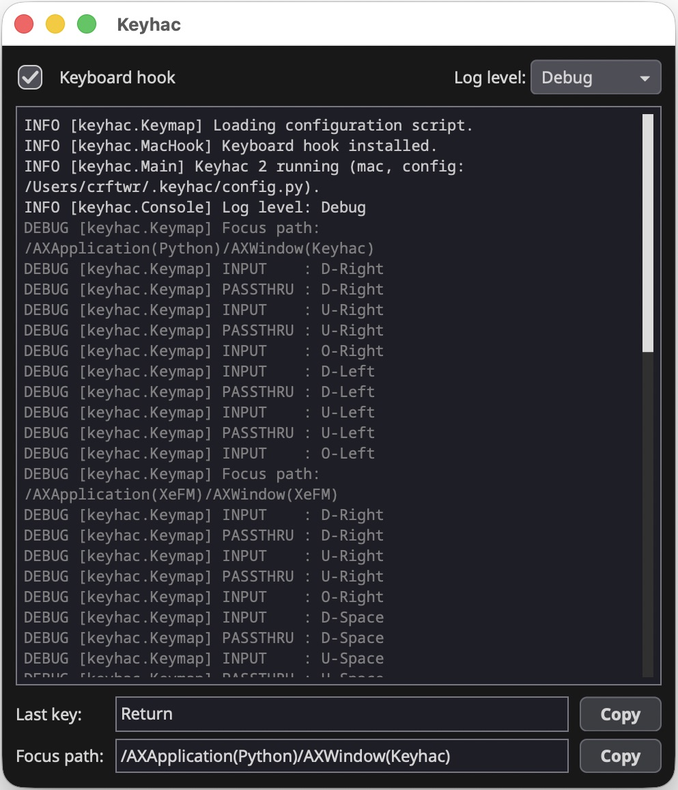
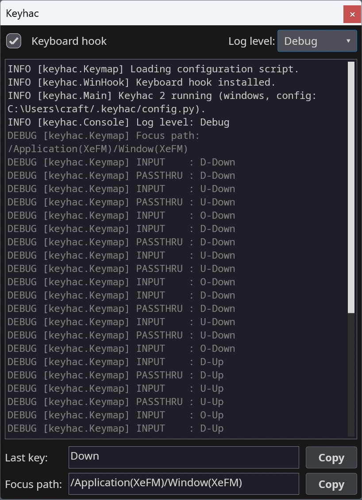
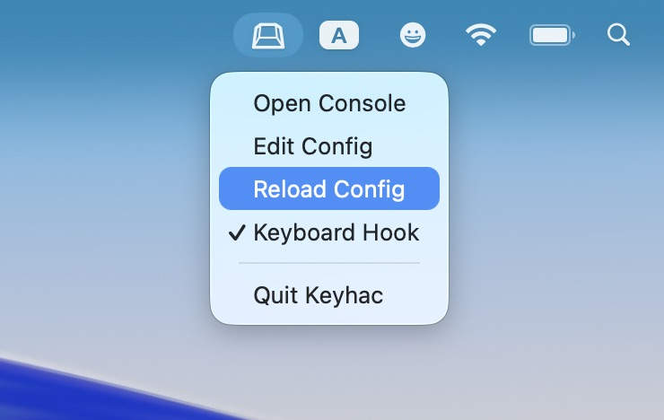
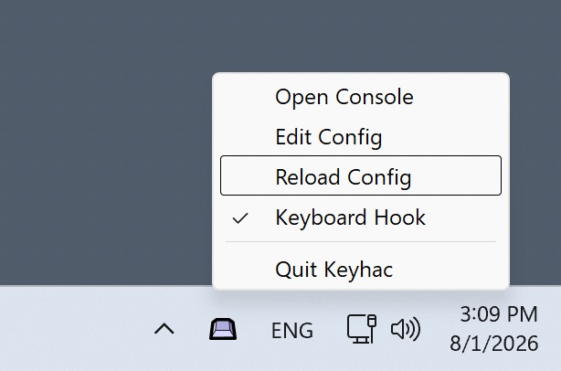

# Keyhac 2

[English](README.md) \| 日本語

**Windows と macOS** で動く、Python でスクリプトを書けるキーボードカスタマイズツールです。

Keyhac はシステム全体のキーボードフックを組み込み、キーの動作を Python で記述できるようにします。
書くファイルは `~/.keyhac/config.py` の 1 つだけで、両方の OS でそのまま動きます。キーのリマップ、
キーへの Python 関数の割り当て、キーボードからのウィンドウ・アプリケーション・クリップボードの操作ができます。

難しいスクリプトは代わりに書かせることもできます。AI アシスタントを接続すると、目の前の画面を読み取り、
実際の UI に対してプレーンな Python のアクションを生成し、テストします。その後、アクションは AI を介さずに単独で動きます。

<!-- pypi-exclude-start -->
<p>
  <a href="https://apps.microsoft.com/detail/9P8H1PG6PRHH">
    
  </a>
  &nbsp;
  <a href="https://github.com/crftwr/keyhac/releases/latest">
    
  </a>
</p>
<!-- pypi-exclude-end -->

Keyhac 2 は、前世代の 2 つの製品、Keyhac for Windows (1.x) と Keyhac for macOS (1.x) を、
1 つの共通コードベースとして作り直して置き換えるものです。これらの旧バージョンの開発は終了しています。
いずれかから移行する場合は、下の[ドキュメント](#ドキュメント)にある移行ガイドを参照してください。
Keyhac 2 の UI は [PuiKit](https://github.com/crftwr/puikit) で作られています。

## 機能

- **キーのリマップ**: キー → キー、キー → キーシーケンス、キー → Python 関数。
- **アプリケーションごとのキーテーブル**: アプリ名、ウィンドウタイトル、Win32 のウィンドウクラス、
  またはアクセシビリティのフォーカスパス全体（macOS では AX、Windows では UI Automation）で一致させます。
  「このアプリのテキストエディター部分だけ」といった指定もできます。
- **ユーザーモディファイア**: 任意のキーを独自のモディファイア (User0–User3) にできます。アプリケーションからは見えません。
- **ワンショットモディファイア**: モディファイアを単独で押して離すと 1 つのアクション、押し続けると修飾として働きます。
- **マルチストロークのキーテーブル**: Emacs 風のプレフィックスキー。入力待ちのプレフィックスをバルーンで表示します。
- **クリップボード履歴**: 永続化された履歴をポップアップのチューザー（選択ウィンドウ）で表示します。
  文字を入力して絞り込み、Enter で元のアプリに書式・画像・ファイルごと貼り付けます。
  Option/Alt-Enter はプレーンテキストとして貼り付けます。さらに固定の定型文と、
  スクリプトで書けるクリップボード変換ツールもあります。
- **ウィンドウ操作**: 移動、スナップ／タイル配置、最小化、アプリケーションのアクティブ化と起動。マルチモニターに対応しています。
- **キーボードマクロ**: キー入力を記録して再生します。
- **マウス出力**: キー割り当てからクリック、ホイールスクロール、ポインターの移動を送ります。
- **追加の Python ライブラリ**: `~/.keyhac/requirements.txt` に列挙し、トレイメニューで
  Advanced > Sync Python Packages を選びます。アプリのバンドル版でも使えます。
- **コンソールウィンドウ**: ライブのログ、最後のキーとフォーカスパスのインスペクター。何を割り当てればよいかが正確にわかります。
  システムトレイ (Windows)／メニューバーアイコン (macOS) から起動します。
- **AI が書くアクション**: AI アシスタントに画面を読ませて自動化を書かせ、それをキーに割り当てます。
  下の [AI 連携](#ai-連携)を参照してください。

## AI 連携

Keyhac は、自動化を *書く* 間は AI アシスタントで操作でき、実行するときは Python だけで動きます。

Claude Desktop（または任意の MCP クライアント）を Keyhac のローカルエンドポイントに接続すると、
目の前のアプリケーションのアクセシビリティツリーを読み取り、そこで見つけた実際の要素名に対して `Action` を書き、
実行し、自分のトレースバックを読んで修正できます。チャットウィンドウとエディターの間でコピー＆ペーストする必要はありません。
最後に残るのは、キーに割り当てられたごく普通の Python クラスです。

```python
import translate_clipboard

def configure(keymap):
    kt = keymap.define_keytable(focus_path_pattern="*")
    kt["Fn-T"] = translate_clipboard.TranslateClipboard()
```

それ以降はミリ秒単位で、オフラインで、トークンもモデルも使わずに動きます。AI は作者であって、実行環境ではありません。
これが最も効くのは、API がまったくないアプリケーションです。ページ送りを最後までたどる、CSV の各行からフォームに入力する、
社内 Web アプリから表を読み出す、すべての設定画面を JSON に書き出す、といった用途です。

**オンにしない限りオフです。** コンソールウィンドウのチェックボックスで切り替えます。エンドポイントはループバックだけで待ち受け、
起動時に生成されるトークンで保護され、開いてから 1 時間後に自動で閉じます。

[AI 連携](doc/ai-integration.ja.md)では、セットアップ、試したことのあるクライアント、アクセスできる範囲、セキュリティモデルを説明しています。

## スクリーンショット

| コンソール (macOS) | コンソール (Windows) |
|---|---|
|  |  |

| メニューバーアイコン (macOS) | タスクトレイ (Windows) |
|---|---|
|  |  |

## インストール

- **macOS 12 以降**: [Releases](https://github.com/crftwr/keyhac/releases) から
  `Keyhac-<version>-macos.dmg` をダウンロードし、Keyhac.app をアプリケーションフォルダーにドラッグして起動します。
  Homebrew でもインストールできます:
  `brew install --cask crftwr/tap/keyhac`。求められたらアクセシビリティ権限を許可してください（キーボードフックに必要です）。
- **Windows 10/11 (x64)**: [Microsoft Store](https://apps.microsoft.com/detail/9P8H1PG6PRHH)
  からインストールします（または `winget install --id 9P8H1PG6PRHH --source msstore`）。自動更新され、
  SmartScreen の警告も出ません。あるいは [Releases](https://github.com/crftwr/keyhac/releases) から
  `Keyhac-<version>-win64.zip` をダウンロードし、任意の場所に展開して `Keyhac.exe` を実行します。

詳細、データの保存場所、プライバシーに関する注意: [doc/installation.ja.md](doc/installation.ja.md)。

## クイックスタート

初回起動時、Keyhac はコメント付きのテンプレートから `~/.keyhac/config.py` を作成します。
トレイ／メニューバーのアイコンから開き（"Edit Config"）、編集して "Reload Config" を選びます。
設定では関数を 1 つ定義します。

```python
from keyhac import *

def configure(keymap):
    kt = keymap.define_keytable(focus_path_pattern="*")   # active everywhere

    kt["Fn-J"] = "Left"                        # key -> key
    kt["Fn-A"] = "Home", "Shift-End"           # key -> sequence

    def hello():                               # key -> Python function
        print("Hello from config.py")
    kt["Fn-H"] = hello

    kt["Fn-V"] = ShowClipboardHistory()        # clipboard history popup

    kt_browser = keymap.define_keytable(app="chrome|Safari")   # per-app table
    kt_browser["Fn-R"] = "Cmd-R"
```

完全なガイドは [doc/configuration.ja.md](doc/configuration.ja.md)、シンボルごとのリファレンスは
[doc/config-api.md](doc/config-api.md) です。同梱のテンプレート
([keyhac/_config.py](keyhac/_config.py)) は、すべての機能を実際に動く形で紹介しています。

## ドキュメント

- [インストール](doc/installation.ja.md): インストール、権限、データファイル、プライバシー。
- [設定](doc/configuration.ja.md): config.py の完全なガイド。
- [API リファレンス](doc/config-api.md): config.py から使えるすべてのクラスと関数と、その正確な引数。
- [AI 連携](doc/ai-integration.ja.md): MCP クライアントの接続、エンドポイントがアクセスできる範囲、セキュリティモデル。
- [アクション API](doc/action-api.md): アクションが他のアプリケーションを操作するための機能。
  ウィンドウの検索、要素ツリーの探索、待機、フィールドへの入力。
- [Keyhac for macOS からの移行](doc/migration-from-keyhac-mac.ja.md): ほぼそのまま使えます。
- [Keyhac for Windows からの移行](doc/migration-from-keyhac-win.ja.md): API の名前が変わりました。対応表があります。
- 旧製品（開発終了、参照用に残しています）:
  [Keyhac for Windows 1.x](https://github.com/crftwr/keyhac-win)、
  [Keyhac for macOS 1.x](https://github.com/crftwr/keyhac-mac)。
- [開発者向けドキュメント](doc/dev/): アーキテクチャ、プラットフォーム層、パッケージング、テスト。
  コーディングエージェント向けのプロジェクトガイド: [CLAUDE.md](CLAUDE.md)。

## ソースから実行する

```sh
python3 -m venv .venv
.venv/bin/pip install -e ".[dev]"
.venv/bin/python -m pytest          # engine + unit tests, no permissions needed
.venv/bin/python -m keyhac          # run (macOS: needs Accessibility permission)
```

`python -m keyhac -d` でデバッグログを有効にし、`--no-ui` で UI なし（フックとエンジンのみ）で実行し、
`--config PATH` で別の設定ファイルを使います（そのデータファイルは設定ファイルの隣に置かれます）。

## 連絡先とサポート

- **GitHub Issues**: [バグ報告や機能の要望](https://github.com/crftwr/keyhac/issues/new/choose)
- **GitHub Discussions**: [質問、アイデア、共有したい設定やアクション](https://github.com/crftwr/keyhac/discussions)
- **セキュリティの問題**: 非公開で報告してください。[SECURITY.md](SECURITY.md) を参照してください
- **コントリビュート**: [CONTRIBUTING.md](CONTRIBUTING.md)
- **PyPI**: [pypi.org/project/keyhac](https://pypi.org/project/keyhac/)（リリース版）
- **作者の X (Twitter)**: [@crftwr](https://x.com/crftwr)

## ライセンス

MIT。[LICENSE](LICENSE) を参照してください。
